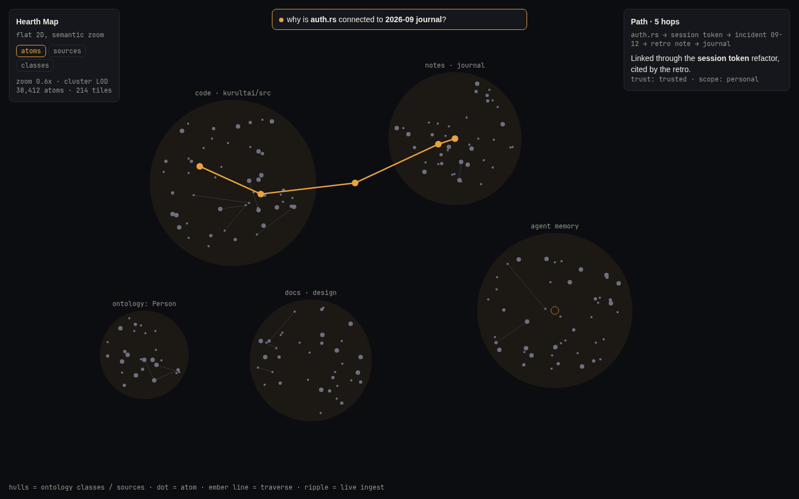
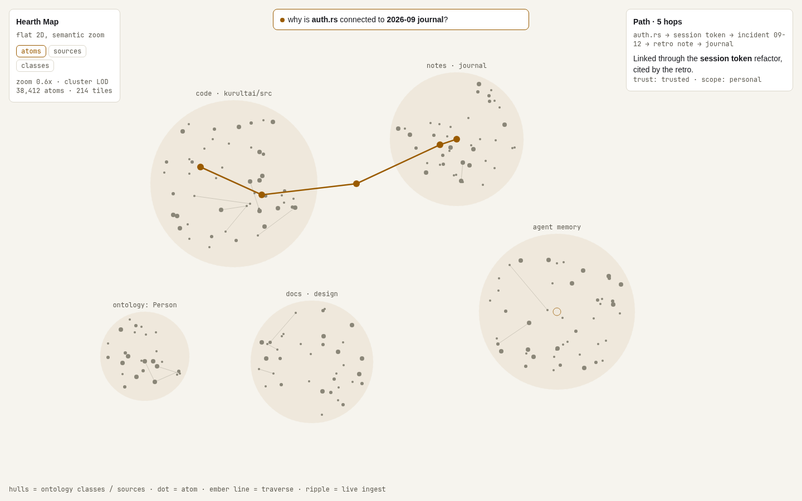
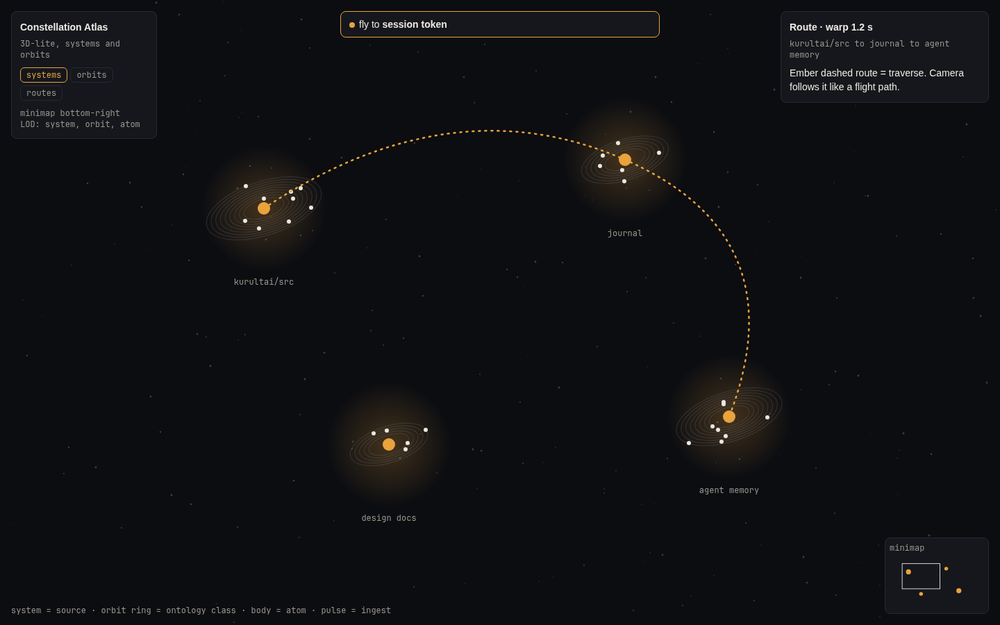
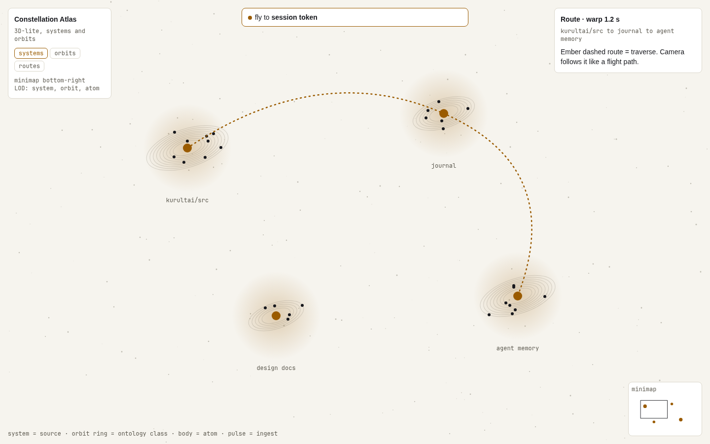
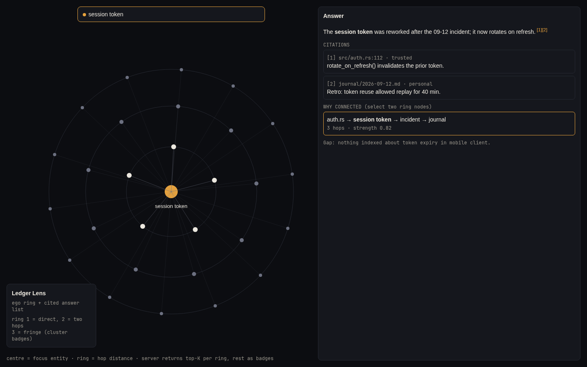
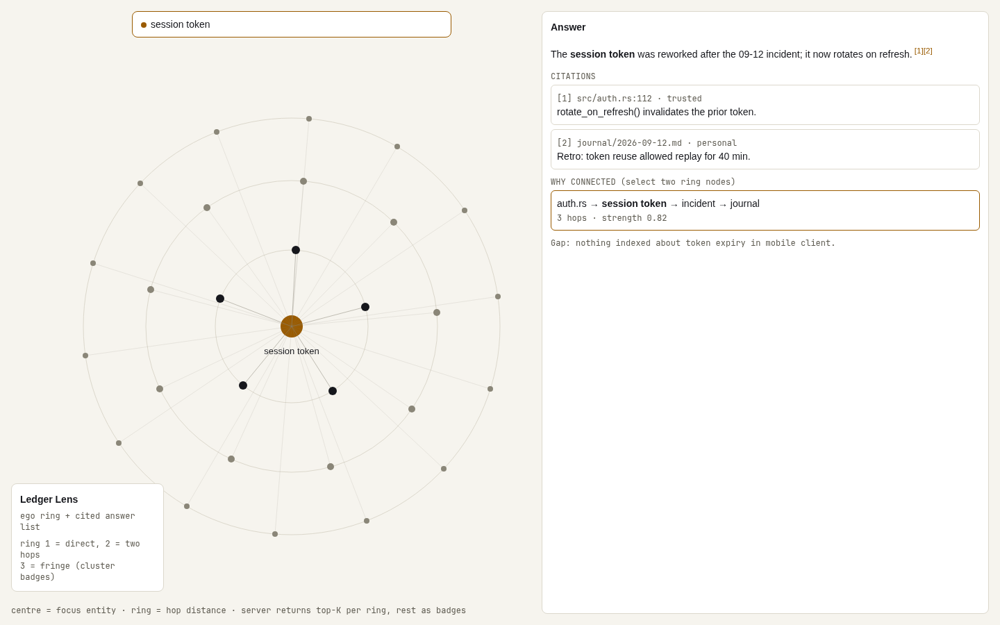

# Brain redesign: three directions (proposal)

Status: proposal. The owner picks one before any build. The current brain (`website/src/brain/`, ui-next) stays untouched; the chosen direction is built alongside under `website/src/brain2/` behind `?brain=next`.

Brand: Council Ring per `DESIGN.md` (ember `#e8a33d` on `#0c0d11`, light tokens `#9a5b00` on `#f6f4ee`). Ember is used only for focus, the traverse path, live ingest and the selected node. Mockups are static HTML+SVG with illustrative data; screenshots (dark and light) are in `brain-redesign/`.

Shared scaling model (all three): the server returns a level-of-detail slice per viewport, never the full graph. Precomputed clusters (source, ontology class, community) at 3 zoom tiers, top-K atoms per cluster by strength, edges only between visible nodes plus cluster-to-cluster aggregate edges. The client holds at most ~2,500 drawn nodes at any zoom, so the 2,500-node cap stops being a corpus limit. Suggested endpoint: `GET /api/brain/tiles?bbox&zoom` and `GET /api/brain/path?from&to`.

Performance budget for the build: initial JS under 300 KB gzipped (current bundle 1.1 MB, ~11 fps at max). Canvas2D or instanced WebGL via a small lib, no Three.js scene graph for A and C; B uses WebGL points/instancing only. Layout runs in a worker and is cached server-side; 60 fps target at 2,500 drawn nodes.

## A. Hearth Map (flat 2D, semantic zoom)

 

Rationale: closest to Obsidian's graph, but with named territory. Hulls are sources and ontology classes; atoms are dots; zoom out collapses hulls into labelled clusters, zoom in reveals atoms and labels. Search-to-fly pans and zooms to the hit and ripples it. "Why connected" is a typed question in the search bar; the answer is an ember polyline across hulls with a one-line explanation card. Selection opens a right-hand inspector (trust lane, scope, citations). Live ingest shows as a ripple on the owning hull. Cheapest to build and fastest, most legible at scale; least spectacular.

## B. Constellation Atlas (3D-lite, systems and orbits)

 

Rationale: a game-map metaphor. Each source is a star system, orbit rings are ontology classes, bodies on the rings are atoms. Search-to-fly warps the camera to the hit (about 1.2 s). The traverse is an ember dashed route the camera follows like a flight path, with a route card for the explanation. A minimap shows viewport over all systems. Pulses are flares on a system when ingest lands. Scale comes from system-level LOD: far away you see only systems, orbits appear on approach, atoms on arrival. Most memorable and closest to the current 3D identity; highest build and perf risk, needs care for accessibility and reduced motion.

## C. Ledger Lens (answer-first, ego ring)

 

Rationale: Perplexity/Notion-style knowledge view. The graph is a small focus ring around one entity (ring 1 direct, ring 2 two hops, ring 3 fringe shown as cluster badges); the main surface is a cited answer with trust and scope on each citation and an explicit gap line. "Why connected": select two ring nodes and the path card lists the hops and strength. Search is the primary navigation (focus entity changes, ring re-centres with a 200 ms tween). Activity shows as a live dot and a recent-changes strip rather than animation. Scales best (server returns top-K per ring) and is lightest, but gives up the whole-brain overview.

## Recommendation

Build A first as the default overview; its tile and path endpoints also serve C's ring and B's systems, so A does not foreclose either.
