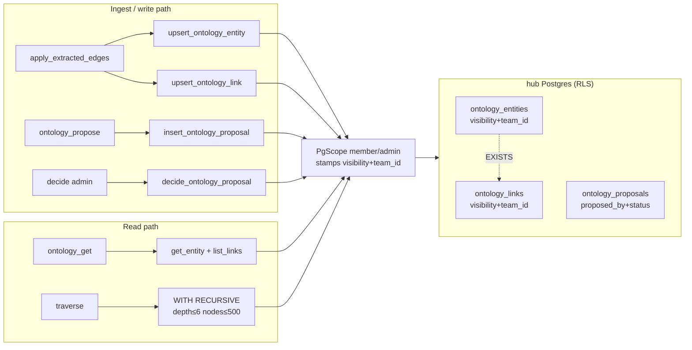

# feat: ontology parity on the Postgres hub + rel-path traversal

## Goal Capsule

- **Objective:** A team member on the Postgres hub gets the same typed-knowledge surface a solo user gets — `ontology_*` tools work, `[[wiki-links]]`/`@mentions` edges persist on ingest instead of silently dropping, members can propose ontology changes for approval, and agents can ask "show me the path between these entities" — all scoped by the same team RLS posture the atoms already carry.
- **Means:** Mirror the SQLite ontology surface on `PostgresStore` — PG DDL + seeds + RLS under the existing `PgScope` GUC model (KTD2), plus a `WITH RECURSIVE` traversal method added to the `Store` trait (KTD5).
- **Authority:** this plan > repo conventions > worker judgment. Session-settled decisions are final unless evidence shows they cannot work.
- **Stop conditions:** solo SQLite behavior changes; personal atoms or team rows become readable cross-team; `traverse` requires a schema migration on solo.

## Product Contract

### Summary

The hub adoption work (plan `docs/plans/2026-10-19-2053-feat-hub-adoption-easy-connect-plan.md`) landed Postgres RLS, scoping, device join, admin authz, and MCP wiring — but left the typed-knowledge layer as stubs. `PostgresStore` returns `"ontology not on hub store yet"` for all 11 stubbed ontology methods and no PG DDL for `ontology_entities`/`ontology_links`/`ontology_proposals` exists; `prune_stale_ontology` is already implemented but hard-errors on the missing tables (failing nightly sweep step 2). Meanwhile `apply_extracted_edges` runs warn-only at ingest, so every linked atom written to the hub silently loses its typed edges. This plan brings the ontology surface to parity under the same RLS model and adds rel-path traversal — the one capability Auto Ontology has that kurultai lacks on any store.

### Problem Frame

Two gaps surfaced after the hub-adoption units landed. First, the ontology layer — entities, typed links, agent-propose/human-approve governance — exists only on SQLite; on the hub lane the MCP tools that read it return errors, and the extraction path that feeds it drops edges silently. A "shared brain" without its typed layer is flat embedding search. Second, nothing in either store traverses the link graph: `multi_hop_expand` hops shared tags, not `ontology_links`. NVIDIA Auto Ontology's differentiator is exactly this — deterministic rel-path queries over a typed graph. Kurultai already has the graph (zero-LLM extraction, proposal governance, actor/confidence provenance); it lacks the query.

### Requirements

- **R1** — PG DDL creates `ontology_entities`, `ontology_links`, `ontology_proposals` on the hub with semantics identical to the SQLite schema (conflict targets, `UNIQUE(from_id,to_id,rel)`, conditional-pending decide, seed rows recreated).
- **R2** — `ontology_entities`/`ontology_links` carry `visibility` (`personal|team|company`) + `team_id` columns; writes stamp scope server-side (KTD2); RLS mirrors the `knowledge_atoms` posture (member: company + own team; admin: all). `ontology_proposals` carries `proposed_by_team` + RLS keyed on it — member sees own team's proposals only, admin sees all; the same policy closes the submit-time dedup oracle.
- **R3** — All 11 stubbed `PostgresStore` ontology methods implemented preserving store-trait semantics, including exact error strings (`"already decided"`, `"not found"`) that `src/http/proposals.rs` status-maps on.
- **R4** — `apply_extracted_edges` stops erroring on the hub: `[[links]]`/`@person`/frontmatter refs persist as `references`/`instance_of` edges on hub ingest.
- **R5** — Seed classes (`class:memory` family + `is_a` links) exist on hub as company-visible `actor='system'` rows.
- **R6** — `traverse` MCP tool performs depth-bounded rel-path traversal over `ontology_links` via `WITH RECURSIVE`, on both SQLite and Postgres, read-scoped like other member tools.
- **R7** — Hub member keys may call `ontology_propose` (the governance path: member proposes, admin decides); `promote`/`ontology_promote`/decide stay admin or human.
- **R8** — Solo lane unchanged: no SQLite schema change required, no solo behavior drift.

### Key Decisions

- **Hey board dropped from hub scope** (`session-settled: user-directed` — board dormant since Oct 9; trait-default errors remain acceptable). Governs scope only.
- **Ontology visibility mirrors atoms** (`session-settled: user-approved` — chosen over global-company and class-global/instance-team hybrid: uniform model, same RLS proof harness). Governs R2.
- **Members may propose** (`session-settled: user-approved` — proposals exist so agents can suggest; decide stays gated). Governs R7.
- **Traverse in scope** (`session-settled: user-directed` — the Auto Ontology steal). Governs R6.

### Scope Boundaries

- **In:** PG ontology DDL/RLS/seeds, 11 store impls, scope stamping, member propose + admin decide, `traverse` on both stores, tests.
- **Out:** an `api/ontology/traverse` HTTP route (no caller — MCP only), Hey-board parity (dropped), agent-identity trait defaults (`register_agent` etc. — different gap-class), `db_rows` default, doctor.rs ontology checks staying SQLite-only, Brain-UI ontology visualization (separate product mode), multi-tenant SaaS.
- **Deferred to follow-up:** sweep `post_report` on PG (needs Hey), ontology-aware sweep census on hub, hub ontology → `web/` console surface.

## Planning Contract

### Key Technical Decisions

- **KTD1** (`session-settled: carried`) — Hub ontology lives in hub Postgres only; solo SQLite keeps its existing schema/behavior untouched (R8).
- **KTD2** — Writes stamp `visibility`/`team_id` server-side; the caller can never supply them. The writer's team resolves as: member principal's `team_id` → else the source atom's `metadata["team_id"]` (ingest/extraction paths, where atoms stamp via metadata rather than `PgScope`) → else `company`/`system` for `Internal` writes with no atom. `closed` scope never writes. Proposal-driven applies (`apply_proposal`, `promote_atom_to_entity` on approve) stamp the **proposer's** team (`proposed_by_team`), not the deciding admin's scope — an approval never widens team-private vocabulary to company.
- **KTD3** — Cross-team stub-slug collisions (`ent:{slug}` global PKs) escalate to `visibility='company'`: a name two teams reference is shared vocabulary. **Mechanism:** a member-scope `INSERT ... ON CONFLICT` cannot see another team's hidden row (it would error — a slug-probing oracle), so stub upserts run under `PathClass::Internal`; the conflict step updates `visibility` only (never other fields) and returns a uniform success whether or not escalation fired. Instance entities bound to atoms (`ent:{atom_id}`) never collide and take the writer's scope. Links carry their writer's scope — a team sees its own links even when an endpoint row is company-level.
- **KTD4** — `decide_ontology_proposal` on hub requires `is_admin` (extends the existing agent-refusal in `src/http/proposals.rs` to admit admin hub keys); member `ontology_propose` reopens by adding the tool to `ToolSurface::HubMember` while the dispatch-level deny stays for `promote`/`ontology_promote` only.
- **KTD5** — `traverse` is a `Store` trait method `traverse_ontology(start_id, rels, max_depth, direction) -> Vec<TraverseHop>` implemented with `WITH RECURSIVE` in **two dialect-specific queries**: Postgres walks a `path` array (`NOT node = ANY(path)`), SQLite walks a delimited string (`INSTR`/`LIKE` cycle guard) — no shared shape, same caps. Hard caps: `max_depth ≤ 6`, `max_nodes = 500`, cycle-guard, timeout-bounded.
- **KTD6** — Member `traverse` runs under `PgScope::member` — RLS limits visible edges automatically; no separate permission model.

### High-Level Technical Design

### Assumptions

- `ALTER DEFAULT PRIVILEGES` in `deploy/server-001/init-hub-db.sql` already grants `kurultai_app` DML on tables `kurultai_migrate` creates later — verified at init-hub-db.sql:68-78; no grant edits needed.
- `WITH RECURSIVE` works identically in SQLite ≥3.8.3 and Postgres — one query shape, placeholder syntax differs.
- Stub entities are name-only artifacts (no content, `atom_id NULL`) — company-escalating a shared slug leaks only a name; accepted residual: a cross-team collision necessarily confirms a name exists elsewhere (bounded to identical-name matches only).

## Implementation Units

### U1. PG ontology DDL + seeds + RLS

**Goal:** the three ontology tables exist on the hub with scope columns, seed rows, and RLS policies — `prune_stale_ontology` and sweep stop erroring.

**Requirements:** R1, R2, R5. **Dependencies:** none.

**Files:** `src/store/migrations.rs`, `deploy/server-001/init-hub-db.sql` (comment only), `tests/hub_ontology.rs` (new).

**Approach:**
1. New `PG_HUB_ONTOLOGY` migration constant in `src/store/migrations.rs` mirroring the SQLite DDL plus `visibility TEXT NOT NULL DEFAULT 'company'` + `team_id TEXT` on entities/links; proposals carry `proposed_by_team TEXT` — the RLS key (R2) that also serves the deferred admin census.
2. Seed the 6 class entities + 5 `is_a` links as `visibility='company'`, `actor='system'` rows.
3. RLS: `ENABLE`+`FORCE` on all three tables — entities/links with the same GUC posture as `knowledge_atoms` (member: `visibility='company' OR team_id=kurultai.team_id`; admin: all); proposals keyed `proposed_by_team = kurultai.team_id` for members, all for admin. Record the coverage verdict comment per the `PG_HUB_RLS` convention.
4. Register the migration in `migrate_locked` after `PG_HUB_DEVICE_FLOWS`.

**Test scenarios (tests/hub_ontology.rs — follow hub_rls.rs provisioning):**
- Fresh migrate creates all three tables with scope columns + seeds present as company/system.
- As `kurultai_app` with `set_config('kurultai.team_id','eng',true)`: eng member sees company seeds + own-team rows, not sales rows.
- `prune_stale_ontology` under Internal scope deletes dangling links then orphaned entities and returns correct counts — no error (regression for current hard-fail).
- Sweep step 2 no longer errors on hub (call the same path sweep.rs:86-91 does).

**Verification:** `cargo test --features postgres` on a pgvector/pgvector:pg16 container per the runbook convention.

### U2. PostgresStore ontology implementations + scope stamping

**Goal:** all 11 stubbed methods implemented with trait-identical semantics; writes stamp scope server-side; extraction persists on hub ingest.

**Requirements:** R2, R3, R4. **Dependencies:** U1.

**Files:** `src/store/postgres.rs`, `src/store/mod.rs` (trait doc notes only if signatures need comment), `tests/hub_ontology.rs`.

**Approach:**
1. Port each SQLite impl preserving semantics exactly: entities `ON CONFLICT (id)`, links `ON CONFLICT (from_id,to_id,rel)` updating `confidence,actor,status` (never `id`), decide as conditional `UPDATE ... WHERE status='pending'` distinguishing not-found vs already-decided with the same error strings, `list_ontology_links(Some)` dual-matching entity id OR `e.atom_id` on either endpoint, `delete_ontology_entity` tx = entity delete + link cascade + 0-rows→error, prune order links→entities.
2. Wrap each in `begin_scope(PathClass::Request)` (member-reachable) or `PathClass::Internal` → `commit_scope`, mirroring existing methods. `prune_stale_ontology` is already implemented — verify it against the new tables, do not rewrite.
3. Stamp `visibility`+`team_id` on every write path (upserts, proposal-driven applies, promote) per the KTD2 writer-team chain — override client-supplied values; proposal applies stamp `proposed_by_team`.
4. Stub upserts execute under `PathClass::Internal` so the conflict step can see existing rows (KTD3): on `ON CONFLICT (id)` where the incoming row is a stub (`atom_id IS NULL`), the stored row's `team_id` differs, and `visibility='team'` — update `visibility='company'` only. Uniform success to the caller either way; no field besides `visibility` mutates on a cross-team conflict. Non-stub conflicts update fields normally within the same scope.
5. Tolerant reader: skip rows whose `rel` fails `OntologyLinkType::parse` (warn) — same as SQLite.
6. Verify `apply_extracted_edges` stops warn-erroring under hub ingest: the pipeline has no request task-local so `PgScope::current()` is `INTERNAL` — extraction writes stamp the source atom's `metadata["team_id"]` per KTD2 (re-enter a captured scope if the pipeline spawns tasks, per the `multi_hop_expand` pattern).

**Test scenarios:**
- Parity matrix vs SQLite for each method (upsert insert+conflict, decide pending/already-decided/not-found error strings, endpoint dual-match, cascade delete).
- Member writes stamp `visibility='team'`+own `team_id` even when caller passes `company`+foreign team (forgery resistance).
- Two teams extract `[[vector-db]]`: first write lands team-scoped, second team's Internal-scope upsert escalates the stub to company — both teams then see the entity; each team's own links remain team-scoped; the second writer's response is identical whether or not escalation fired (no slug oracle).
- `apply_extracted_edges` on hub persists `references` + `instance_of` edges (integration: ingest a linked atom, assert link rows).
- Member cannot read another team's entity/link rows via any list/get path (RLS negative).
- Admin approves an eng member's proposal → applied entity/link lands `visibility='team'`, `team_id='eng'` — not company (SEC-2 regression).
- `list_ontology_proposals` + submit-time dedup under member scope see only own-team proposals — a foreign team's pending proposal returns no dedup hit and no payload (SEC-3).
- Ingest a team atom with `[[links]]` under INTERNAL scope → edges land stamped with the atom's `team_id`, `visibility='team'`.
- Corrupt `attributes_json`/`payload_json` row → parses as `{}` (tolerant read).

**Verification:** `cargo test --features postgres`; clippy; fmt.

### U3. Member `ontology_propose` + admin decide on hub

**Goal:** members get the governance lane (propose → pending → admin decides); promote/decide stay gated.

**Requirements:** R7. **Dependencies:** U2.

**Files:** `src/mcp/server.rs`, `src/http/proposals.rs`, `tests/hub_ontology.rs` or `tests/hub_mcp.rs` (match existing home).

**Approach:**
1. `ToolSurface::HubMember` gains `ontology_propose` (and keeps `ontology_get`/`ontology_proposals` reads); the dispatch-level member deny at server.rs:793-802 shrinks to `promote`/`ontology_promote` only.
2. `src/http/proposals.rs` decide path: check `principal.is_admin()` **before** the `agent_id` refusal at proposals.rs:156 — every hub key carries `agent_id`, member and admin alike; the reorder admits admin keys while member keys still refuse. Keep the no-principal operator lane (static key / CF Access) deciding as today (SEC-5).
3. Audit: decide/submit events log to `hub_activity` consistent with U4-of-previous-plan admin actions.

**Test scenarios:**
- Member key → `ontology_propose` (new_link/new_entity) → 200, lands pending with `proposed_by` set.
- Member key → decide → 403; admin key → approve → entity/link lands `approved` with correct actor; reject → status only.
- Member key → `promote`/`ontology_promote` → still denied at dispatch.
- Member sees own-team proposals only via `ontology_proposals`; admin sees all.
- Static-key/operator credential (no `HubPrincipal`) → decide still works (human-lane regression).
- `server.rs:526-528` comment updated alongside the surface change.

**Verification:** same as U2.

### U4. `traverse` rel-path tool on both stores

**Goal:** agents can ask for the typed path between entities — the Auto Ontology differentiator — on solo and hub.

**Requirements:** R6. **Dependencies:** U1 (PG tables exist); the SQLite side has no dependency.

**Files:** `src/store/mod.rs` (trait + types), `src/store/postgres.rs`, `src/mcp/server.rs`, `src/mcp/brain.rs` or `src/ontology/mod.rs` (traversal helper — match existing placement), `src/types.rs` (`TraverseHop`), `tests/hub_ontology.rs` + SQLite-side test home.

**Approach:**
1. `Store::traverse_ontology(start_id, rels: &[OntologyLinkType], max_depth, direction) -> Result<Vec<TraverseHop>>` — `TraverseHop { entity_id, rel, from_id, depth }` (shape finalized at implementation; deferred detail).
2. `WITH RECURSIVE` walk: seed `from_id = start`, join links per `direction` (out|in|both), `rels` filter optional, path-array cycle guard, caps per KTD5. One query shape for both stores; placeholder syntax per dialect.
3. MCP tool `traverse` on Full + HubMember surfaces (read-only; member runs under `PgScope::member` so RLS trims the walk naturally — a walk hitting an invisible edge just stops).
4. No HTTP traverse endpoint — no caller exists; MCP-only until one does.

**Test scenarios:**
- Linear chain a→b→c returns ordered hops with depth; `rels=[is_a]` vs all-rels filter.
- Cycle a→b→a terminates via path guard, no dupes.
- max_depth truncation; nonexistent start → empty vec (not error).
- Member traverse stops at a cross-team edge (RLS) while admin sees through.
- Solo SQLite parity: same graph → same hop set.

**Verification:** same as U2; clippy both feature sets.

### U5. Docs + INDEX parity

**Goal:** docs and indexes describe the hub's full tool surface truthfully.

**Requirements:** supporting. **Dependencies:** U2–U4.

**Files:** `docs/runbook-hub.md`, `docs/AGENT_CONNECTION_PROMPT.md` (tool list), `src/INDEX.md` and touched-folder INDEX.md rows, root `INDEX.md` Recent.

**Approach:** update the "tools unavailable on hub" language landed by U6-of-previous-plan; document member propose/admin decide posture, `traverse`, and the KTD3 collision rule; note doctor.rs ontology checks remain SQLite-only.

**Test scenarios:** `Test expectation: none — docs/index updates; audit-agent-index.py is the gate.`

**Verification:** `python3 scripts/audit-agent-index.py` green.

## Verification Contract

- `cargo test --features postgres` on a `pgvector/pgvector:pg16` container (`KURULTAI_TEST_DATABASE_URL`, `deploy/server-001/init-hub-db.sql` applied first) — new `tests/hub_ontology.rs` green plus no regressions in `hub_rls`, `hub_admin`, `hub_mcp`, `connect_hub`.
- `cargo test --locked` (default features) — solo SQLite ontology + traverse tests green.
- `cargo clippy --features postgres --all-targets -- -D warnings` and plain clippy clean; `cargo fmt --all -- --check` clean.
- `python3 scripts/audit-agent-index.py` green.
- Non-owner `kurultai_app` proofs: member-scoped SELECT on the new tables returns zero cross-team rows; admin GUC returns all.

## Definition of Done

- Every `ontology_*` MCP tool + `traverse` returns real data on the hub for member and admin keys (no `"not on hub store yet"` anywhere).
- Linked-atom ingest on hub persists typed edges; `kurultai sweep` on hub completes step 2.
- Member proposes → admin decides end-to-end; member cannot promote/decide or read foreign-team ontology rows.
- `traverse` returns identical hop sets on SQLite and Postgres for the same graph, with caps enforced.
- Solo lane tests all green; no abandoned-attempt code in the diff; INDEX rows updated and audit green.
